<!-- set by assets/readme/gen.py — edit that, not this -->

<a href="https://github.com/L0stInFades"></a>
<a href="https://github.com/L0stInFades"><picture><source media="(prefers-color-scheme: dark)" srcset="assets/readme/epigraph-dark.svg">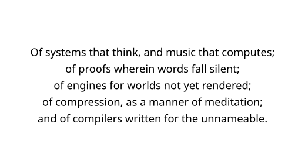</picture></a>
<a href="https://github.com/L0stInFades"><picture><source media="(prefers-color-scheme: dark)" srcset="assets/readme/statement-dark.svg">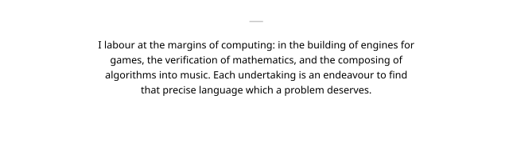</picture></a>
<a href="https://edyt.video"><picture><source media="(prefers-color-scheme: dark)" srcset="assets/readme/sec-1-dark.svg"></picture></a>
<a href="https://edyt.video"><picture><source media="(prefers-color-scheme: dark)" srcset="assets/readme/now-edyt-dark.svg"></picture></a>
<a href="https://github.com/L0stInFades?tab=repositories"><picture><source media="(prefers-color-scheme: dark)" srcset="assets/readme/sec-2-dark.svg"></picture></a>
<a href="https://github.com/L0stInFades/Afterglow"><picture><source media="(prefers-color-scheme: dark)" srcset="assets/readme/work-01-afterglow-dark.svg">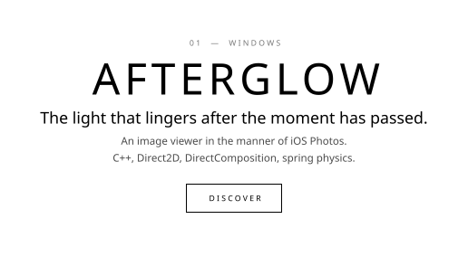</picture></a>
<a href="https://github.com/L0stInFades/vien"><picture><source media="(prefers-color-scheme: dark)" srcset="assets/readme/work-02-vien-dark.svg">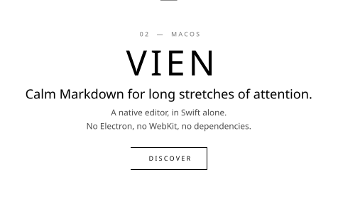</picture></a>
<a href="https://github.com/L0stInFades/echo-read"><picture><source media="(prefers-color-scheme: dark)" srcset="assets/readme/work-03-lector-dark.svg">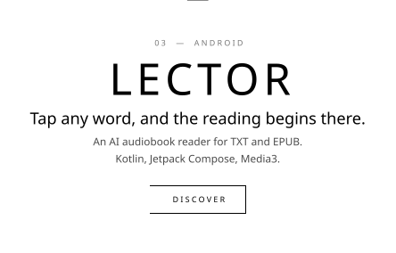</picture></a>
<a href="https://github.com/L0stInFades/Unfold"><picture><source media="(prefers-color-scheme: dark)" srcset="assets/readme/work-04-unfold-dark.svg">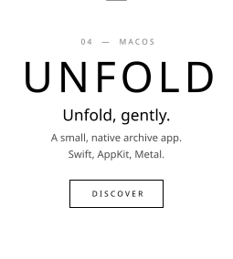</picture></a>
<a href="https://github.com/L0stInFades"><picture><source media="(prefers-color-scheme: dark)" srcset="assets/readme/sec-3-dark.svg"></picture></a>
<a href="https://github.com/L0stInFades"><picture><source media="(prefers-color-scheme: dark)" srcset="assets/readme/instruments-dark.svg"></picture></a>
<a href="https://github.com/L0stInFades"><picture><source media="(prefers-color-scheme: dark)" srcset="assets/readme/sec-4-dark.svg"></picture></a>
<a href="https://github.com/L0stInFades"><picture><source media="(prefers-color-scheme: dark)" srcset="assets/readme/ledger-dark.svg">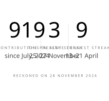</picture></a>
<a href="https://github.com/L0stInFades"><picture><source media="(prefers-color-scheme: dark)" srcset="profile-3d-contrib/profile-dark.svg">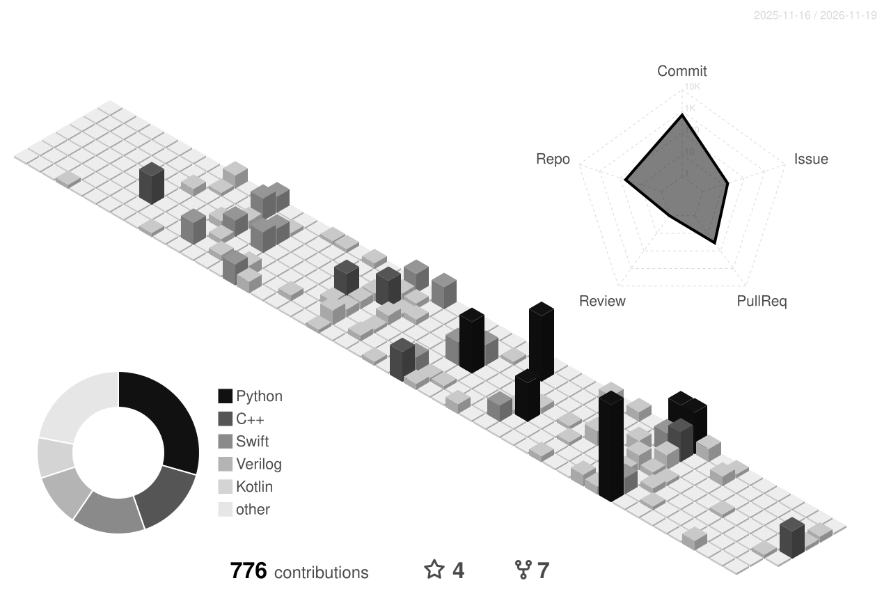</picture></a>
<a href="https://github.com/L0stInFades"><picture><source media="(prefers-color-scheme: dark)" srcset="https://raw.githubusercontent.com/L0stInFades/L0stInFades/output/snake-dark.svg"></picture></a>
<a href="https://github.com/L0stInFades"><picture><source media="(prefers-color-scheme: dark)" srcset="assets/readme/colophon-dark.svg">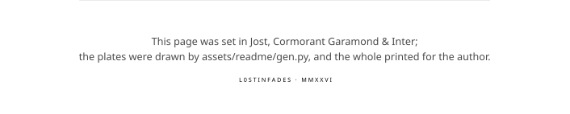</picture></a>

